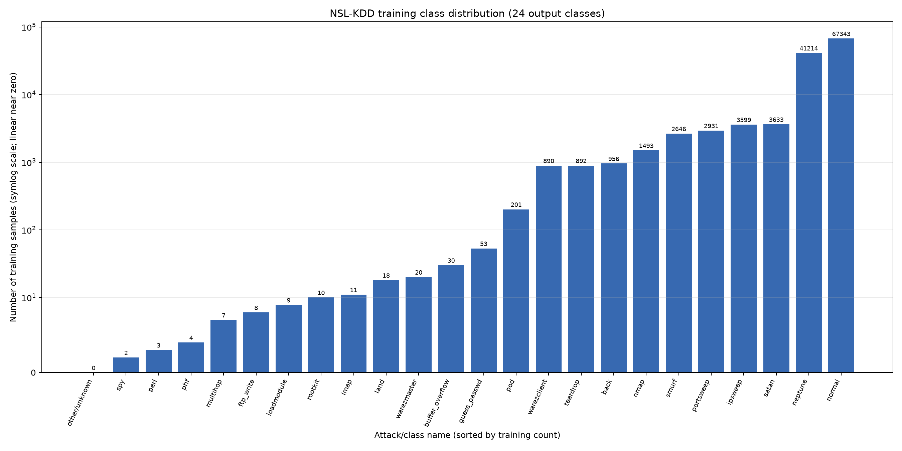

# NSL-KDD Class Imbalance Analysis

## Training class counts

- **Total training samples:** 125,973
- **Number of output classes:** 24
- **Majority class:** normal (class 0), 67,343 samples (53.4583%)
- **Minority class:** other/unknown (class 23), 0 samples (0.0000%)
- **Imbalance ratio (majority / minority):** Undefined/infinite (the minimum class count is zero, so division by zero is not defined).

Class counts were obtained by loading the training split and applying the existing saved preprocessing artifact with `transform_dataset()`. No encoder or scaler was fitted, and the production artifact was not written.

## Five most frequent classes

| Class ID | Class | Training samples | Percentage | Baseline test precision | Baseline test recall | Baseline test F1 | Test support |
|---:|---|---:|---:|---:|---:|---:|---:|
| 0 | normal | 67,343 | 53.4583% | 0.6129 | 0.9296 | 0.7387 | 9,711 |
| 10 | neptune | 41,214 | 32.7165% | 0.9319 | 0.9936 | 0.9618 | 4,657 |
| 17 | satan | 3,633 | 2.8840% | 0.6587 | 0.9741 | 0.7859 | 735 |
| 6 | ipsweep | 3,599 | 2.8570% | 0.8059 | 0.9716 | 0.8810 | 141 |
| 15 | portsweep | 2,931 | 2.3267% | 0.7228 | 0.8471 | 0.7801 | 157 |

## Five least frequent classes

| Class ID | Class | Training samples | Percentage | Baseline test precision | Baseline test recall | Baseline test F1 | Test support |
|---:|---|---:|---:|---:|---:|---:|---:|
| 23 | other/unknown | 0 | 0.0000% | 0.0000 | 0.0000 | 0.0000 | 3,750 |
| 19 | spy | 2 | 0.0016% | 0.0000 | 0.0000 | 0.0000 | 0 |
| 12 | perl | 3 | 0.0024% | 0.0000 | 0.0000 | 0.0000 | 2 |
| 13 | phf | 4 | 0.0032% | 0.0000 | 0.0000 | 0.0000 | 2 |
| 9 | multihop | 7 | 0.0056% | 0.0000 | 0.0000 | 0.0000 | 18 |

## Comparison with baseline per-class evaluation

The precision, recall, F1, and support columns above are from the **existing baseline test classification report**; they are not training-set metrics. Test support can differ from training counts. This comparison is descriptive and does not establish that low training frequency caused any particular result.

Bottom-five baseline metrics:
- **other/unknown** (training n=0; baseline test support=3,750): precision 0.0000, recall 0.0000, F1 0.0000.
- **spy** (training n=2; baseline test support=0): precision 0.0000, recall 0.0000, F1 0.0000.
- **perl** (training n=3; baseline test support=2): precision 0.0000, recall 0.0000, F1 0.0000.
- **phf** (training n=4; baseline test support=2): precision 0.0000, recall 0.0000, F1 0.0000.
- **multihop** (training n=7; baseline test support=18): precision 0.0000, recall 0.0000, F1 0.0000.

Additional positive-training-count classes with zero baseline test F1:
- **ftp_write**: 8 training samples; baseline test support 3; F1 0.0000.
- **imap**: 11 training samples; baseline test support 1; F1 0.0000.
- **loadmodule**: 9 training samples; baseline test support 2; F1 0.0000.
- **multihop**: 7 training samples; baseline test support 18; F1 0.0000.
- **perl**: 3 training samples; baseline test support 2; F1 0.0000.
- **phf**: 4 training samples; baseline test support 2; F1 0.0000.
- **rootkit**: 10 training samples; baseline test support 13; F1 0.0000.
- **spy**: 2 training samples; baseline test support 0; F1 0.0000.
- **warezclient**: 890 training samples; baseline test support 0; F1 0.0000.
- **warezmaster**: 20 training samples; baseline test support 944; F1 0.0000.

The reserved `other/unknown` class has zero training samples by construction and zero F1 in the baseline report; this confirms it has no positive training examples in this setup, not that the model learned unknown-attack detection. Other low-frequency classes show mixed baseline test precision/recall/F1, while some more frequent classes also have weak results. These descriptive observations do **not** demonstrate that imbalance caused the baseline performance.

## Factual interpretation

The training distribution is highly uneven, and the reserved other/unknown output has no training examples, making the majority/minority ratio undefined as a finite number. Several known attack categories have much smaller training counts than the majority class. This imbalance motivates investigating whether class-weighted training changes minority-class metrics; that remains a research hypothesis and has not been tested here.

## Visualization

The chart uses a symmetric-logarithmic vertical scale so that low-frequency categories remain visible alongside the majority class.
